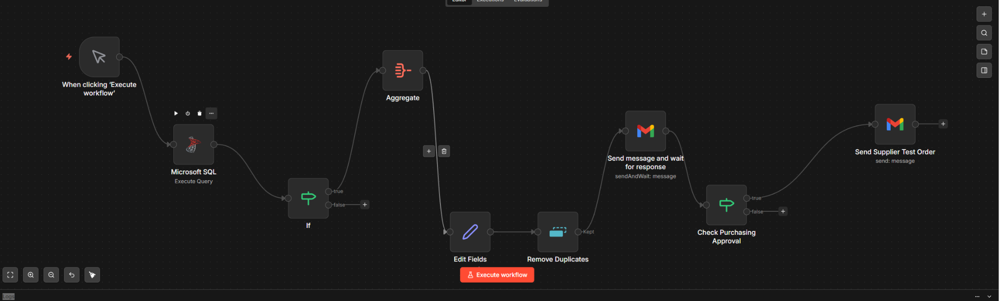
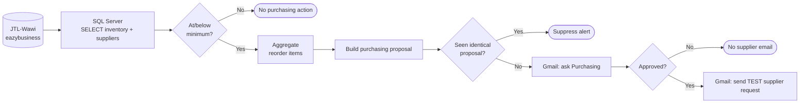

# JTL-Wawi Purchasing Automation | n8n + SQL Server

**A local ERP-to-email purchasing automation proof of concept with human approval.**

An independently built simulation for a fictional pool-products retailer, inspired by real-world e-commerce replenishment challenges. JTL-Wawi supplies product, inventory and supplier data; SQL calculates reorder flags and demo quantities; n8n groups the proposed purchases, requests approval via Gmail, and sends a **test-only** supplier request only when approved.

> **Scope:** Local, manually triggered MVP v1.0, closed 2 November 2026. This was **not built for or deployed at POOL Total GmbH**. All products and suppliers are fictional. It does **not** create a native JTL purchase order or contact a real supplier.

## Outcome at a glance

| Metric | Observed demo result |
|---|---:|
| Inventory SKUs read from JTL | **5** |
| SKUs at or below minimum stock | **3** |
| SKUs with sufficient stock | **2** |
| Proposed replenishment | **52 units** |
| Simulated total supplier cost | **€810.00 net** |
| Approval / rejection routing | **Both tested** |
| Exact duplicate fingerprint | **First kept, repeat discarded** (node-level test) |

The replenishment policy is **an explicit simulation assumption**, not a business forecasting model: when stock is at or below minimum, target stock is twice the configured minimum. Supplier communication happens only after a human approval decision.

## Architecture

**Architecture note:** The duplicate rule was verified in isolation after the original end-to-end email flow. Full-chain regression testing after inserting that node remains a documented follow-up.

## Screenshots / evidence

| Evidence | View |
|---|---|
| Full n8n workflow | [Workflow canvas](screenshots/01-workflow-overview.png) |
| Enriched SQL results, including suppliers | [SQL output](screenshots/02-sql-inventory-output.png) |
| Purchasing proposal with approval buttons | [Approval email, header cropped](screenshots/03-purchasing-approval.png) |
| Supplier request received after approval | [Supplier email, header cropped](screenshots/04-supplier-email.png) |
| Exact proposal first accepted | [Duplicate check: kept](screenshots/05-duplicate-first-kept.png) |
| Second identical proposal blocked | [Duplicate check: discarded](screenshots/06-duplicate-repeat-discarded.png) |
| Rejection did not execute supplier node | [Rejection branch](screenshots/07-rejection-branch.png) |

The email screenshots are **cropped to exclude the account header and personal address**. No real supplier was contacted.

## Technology

- **ERP:** JTL-Wawi 2.2.2 with five fictional products, warehouse stock and a fictional supplier
- **Database:** Microsoft SQL Server 2022 (`eazybusiness`), queried through a read-only SQL account
- **Workflow automation:** Self-hosted n8n in Docker, Microsoft SQL, IF, Aggregate, Edit Fields, Remove Duplicates, Gmail nodes
- **Human-in-the-loop:** Email approval (`Approve and Disapprove`) with supplier notification only after positive approval

## Source files and documentation

| Path | Purpose |
|---|---|
| [`sql/jtl_inventory_replenishment.sql`](sql/jtl_inventory_replenishment.sql) | **Working** enriched SQL query, including supplier joins and reorder calculation |
| [`data/sample_inventory.csv`](data/sample_inventory.csv) | Fictional sample output matching the verified five-SKU run; **not** the live n8n data source |
| [`docs/ARCHITECTURE.md`](docs/ARCHITECTURE.md) | Node-by-node behavior, settings and expressions |
| [`docs/TEST_RESULTS.md`](docs/TEST_RESULTS.md) | What was directly tested and what was not |
| [`docs/LIMITATIONS_AND_ROADMAP.md`](docs/LIMITATIONS_AND_ROADMAP.md) | MVP boundaries and next priorities |
| [`docs/SCREENSHOT_GUIDE.md`](docs/SCREENSHOT_GUIDE.md) | Evidence checklist and safe-screenshot policy |
| [`docs/EXPORT_AND_SECURITY.md`](docs/EXPORT_AND_SECURITY.md) | How to add a sanitized n8n export safely |
| [`docs/PROJECT_CONTEXT_FULL.md`](docs/PROJECT_CONTEXT_FULL.md) | Expanded technical/business handover for future LLM-assisted work |
| [`workflows/README.md`](workflows/README.md) | Status of n8n JSON export and reproducibility notes |

**Workflow JSON export pending:** Screenshots are proof of the built workflow, but a true importable workflow JSON cannot be reconstructed faithfully from screenshots. Export it from your own n8n editor, review it for sensitive information, and place a sanitized JSON file under `workflows/` as a follow-up. See [export/security notes](docs/EXPORT_AND_SECURITY.md).

## Verified behavior

1. SQL read **five** fictional JTL products with supplier details.
2. Condition `available_stock <= minimum_stock` flagged **POOL-001, POOL-003, POOL-004**, including the equality case for POOL-003.
3. n8n assembled **one purchasing proposal** for **€810.00 net**.
4. An approval email was received; a clicked approval returned `data.approved = true` and the test supplier email arrived.
5. A separate rejection returned the **False** branch and did not execute the supplier node.
6. The Remove Duplicates node **kept** the first unique fingerprint and **discarded** the identical second fingerprint in two isolated executions.

**Not claimed:** production deployment, business ROI, native ERP PO generation, real suppliers, automated scheduling, error alerts, or complete post-deduplication regression testing.

## Key limitations

This is **not production-ready procurement automation**. The supplier Gmail recipient and some email subject/total text are hardcoded for the demo; the basic duplicate identifier lacks order lifecycle state; stock movement after an approved email could generate a new proposal; missing data and multi-supplier scenarios are untested; error-handler configuration was deferred. See the [prioritized roadmap](docs/LIMITATIONS_AND_ROADMAP.md).

## Reproduction / safe use

A real JTL-Wawi database and SQL Server instance are needed to run the SQL against ERP data. The CSV is provided only so readers can inspect the example dataset without JTL. The workflow should be imported only from the **actual sanitized export**, then configured with the reader's own SQL and Gmail credentials. **Never run this demo against live purchasing systems or real suppliers.**
